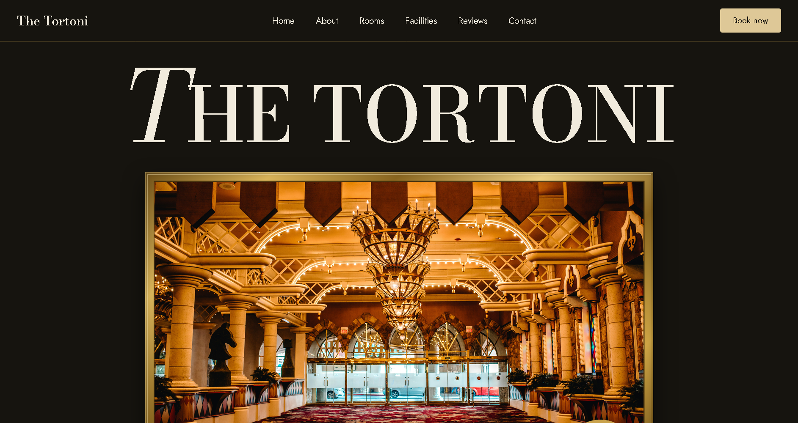

# The Tortoni

A boutique-hotel website concept with an art-gallery identity, inspired by Édouard Manet's painting *Chez Tortoni*. Built with React and Vite as a portfolio piece and as a re-skinnable starting point for real hotel clients.

**Live demo:** [the-tortoni-demo.netlify.app](https://the-tortoni-demo.netlify.app/)



> **Note:** The Tortoni is a fictional hotel created as a design concept. It is not affiliated with Café Tortoni or any real hotel.

## Design concept

The site treats the hotel as a gallery on a Paris boulevard: an ink-black ground, bare-canvas cream type, café green feature bands and gilt-gold details, all drawn from the palette of the painting. Rooms are named after Manet works (*Le Balcon*, *Argenteuil*, *Folies-Bergère*) but always paired with a plain room type, so the site reads as a hotel at a glance.

## Features

- **Gilded frame component.** A reusable pure-CSS picture frame (no image files) wraps the hero, room photos and facilities.
- **Opening-window hero.** The framed photo opens out on page load, followed by staggered text. All motion respects `prefers-reduced-motion`.
- **Availability bar.** Check-in, check-out and guests, with date validation. It opens WhatsApp with the enquiry pre-filled, which suits direct bookings.
- **Data-driven content.** Rooms, facilities, reviews and contact details live in `src/data/`.
- **Scroll reveals.** A small reusable hook (`useReveal`) built on `IntersectionObserver`.
- **Responsive and accessible.** Mobile-first layouts, labelled form controls, visible focus states and semantic landmarks.
- **Performance-minded.** Lazy-loaded images with explicit dimensions, two font families, no UI framework and no animation libraries.

## Tech stack

- [React](https://react.dev/) and [Vite](https://vite.dev/)
- Plain CSS with custom properties for theming
- Google Fonts: Bodoni Moda and Jost
- Remix Icon
- Hosted on [Netlify](https://www.netlify.com/)

## Project structure

```
src/
  assets/images/     Photography and artwork
  components/
    Nav/             Fixed navigation with mobile menu
    Hero/            Framed hero with opening animation
    AvailabilityBar/ Date picker that opens WhatsApp
    RoomsPreview/    Room cards
    Story/           Brand story band
    Facilities/      Terrace, Salon, Pool & Garden
    Reviews/         Guest quotes
    Reserve/         Final booking call to action
    Footer/
    GiltFrame/       Reusable gilded frame
  data/
    site.js          Hotel details, facilities, reviews
    rooms.js         Room data
  hooks/
    useReveal.js     Scroll-reveal hook
  index.css          Theme tokens and global styles
```

## Design tokens

| Token | Value | Use |
| --- | --- | --- |
| Ink | `#16140F` | Page background |
| Canvas | `#F1EBDD` | Text and light surfaces |
| Café green | `#2E3B32` | Feature bands |
| Gilt | `#C9A24C` | Accents, lines, large type |
| Warm grey | `#8C857A` | Secondary tones |

## Roadmap

- Full Rooms page and Room details pages with React Router
- Contact page with map and enquiry form
- Per-hotel theme switching

## Credits

- **Photography:** [Unsplash](https://unsplash.com/), used under the [Unsplash License](https://unsplash.com/license). First Hero image from [Manuel Moreno](https://unsplash.com/@manuelmx), second Hero image from [Omar Rodriguez](https://unsplash.com/@e90two), the Classic Room preview image from [Marcel Strauß](https://unsplash.com/@martzzl), the Deluxe Room preview image from [visualsofdana](https://unsplash.com/@visualsofdana), the Executive Suite preview image from [Spacejoy](https://unsplash.com/@spacejoy), the Terrace image from [Alef Morais](https://unsplash.com/@alef_visuals), The Salon image from [Justin Chien](https://unsplash.com/@justinchien), Pool and Garden image from [Robin Glauser](https://unsplash.com/@nahakiole).

- **Painting:** Édouard Manet, *Chez Tortoni*, c. 1878–80, via [Wikimedia Commons](https://commons.wikimedia.org/wiki/File:%C3%89douard_Manet_Chez_Tortoni.jpg#Licensing). Public domain.

- **Fonts and icons:** Bodoni Moda and Jost from Google Fonts, and Remix Icon, used under their respective open licences.

## Author

Designed and built by **Ekan** ([Qreak](https://github.com/UNiEK23)). Open to freelance web projects.

## Licence

Source code © 2026 Ekan. All rights reserved. Photography and artwork remain the property of their respective owners, as credited above.
